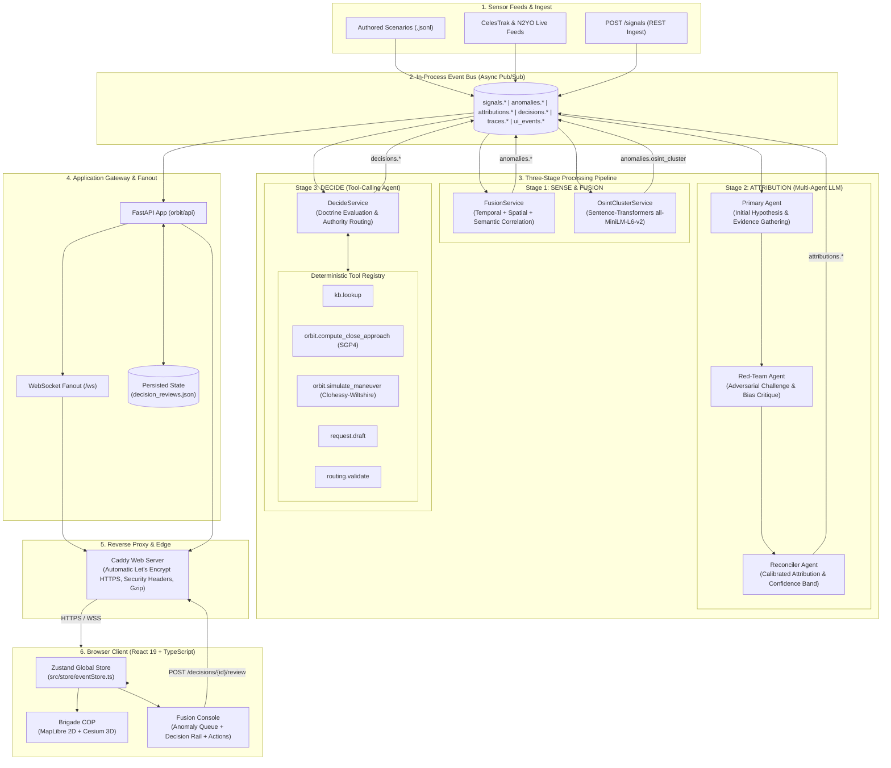

# Handover Document & Technical Notes: ORBIT Cloud Project Report

> **Target Audience**: Coursework teammate preparing the CA3 Cloud Mini-Project Report.  
> **Repository**: [https://github.com/KoroS11/ORBIT](https://github.com/KoroS11/ORBIT)  
> **Author/Maintainer**: Harsh (with AI assistant)  
> **Last verified against the deployment on**: October 11, 2026  
> **Last Updated**: October 2026

---

## CA3 Cloud Coursework Evaluation Rubric Mapping

The CA3 Cloud Mini-Project Report is evaluated based on three primary criteria totaling 10 marks. The table below maps each rubric item directly to the relevant sections in this document along with the required evidence:

| Rubric Component | Marks | Key Focus & Scope | Mapping to Sections in this Document | Required Evidence & Status |
|---|---|---|---|---|
| **Design, Setup and Configuration** | **2 Marks** | Architectural design, problem formulation, component relationships, resource sizing, environment configuration, and local verification. | **Sections 1, 2, 3, 6, 8** | • Architecture Mermaid diagram<br>• Docker Compose resource caps (`mem_limit: 1400m`)<br>• Environment configuration table<br>• Pre-downloaded ML model strategy (`MiniLM`) |
| **Implementation and Cloud Deployment** | **3 Marks** | Working AWS deployment, clean step-by-step execution, domain DNS, reverse proxy TLS, memory safety, and service health. | **Sections 4, 7, 8, 10, 11, 12** | • Step 0 AWS instance launch & DuckDNS setup<br>• SSH access with `ORBIT-key.pem`<br>• 4 GiB swapfile & Docker installation<br>• `docker compose ps` & `docker stats` verification<br>• HTTPS endpoint curl & HSTS security headers<br>• Elastic IP association (`13.126.207.91`)<br>• *Pending*: Live SSL browser padlock screenshot `[PENDING-HARSH]` |
| **Report Writing, Cloud Setup, CI/CD & Code Repo** | **5 Marks** | Clear narrative, thorough cloud setup walkthrough, complete CI/CD automation to GHCR, GitHub repository link, and deployment validation. | **Sections 9, 13, 14, 15, 16** | • Exact GitHub Actions workflow (`ci.yml`) breakdown<br>• Least-privilege GITHUB_TOKEN & container tags on GHCR<br>• Clear note on manual EC2 pull vs automated CD<br>• Public GitHub repository link<br>• 2-Minute evaluation demo script<br>• Report screenshot checklist (AWS console, billing, terminal, UI) |

### Suggested Report Outline (~70% Cloud Setup, Deployment & CI/CD)

The coursework report should be weighted heavily toward cloud infrastructure, container orchestration, and continuous delivery:

1. **Title, Executive Summary & Public Repository (5%)**:
   - Project name, author, GitHub repository link ([https://github.com/KoroS11/ORBIT](https://github.com/KoroS11/ORBIT)), and live URL.
   - 1-paragraph summary of ORBIT as an edge-capable tactical multi-domain situational awareness and orbital protection system.
2. **System Architecture & Local Design (15%)**:
   - Problem context: multi-domain operational stovepipes (RF/EW, PNT, Cyber, Space RPO).
   - Event-driven pipeline: Sense $\to$ Fuse $\to$ Attribute $\to$ Decide $\to$ Act.
   - Multi-agent debate reasoning (Primary attribution, Red-team challenge, Reconciler calibration) and deterministic orbital tool calling.
   - Local quality gates (pytest suite, ESLint, Vite build, `verify.py`).
3. **Cloud Infrastructure Setup on AWS (25%)**:
   - AWS EC2 `t3.small` instance selection rationale (2 vCPU, 2.0 GiB RAM) balancing compute against AWS Free Tier budget.
   - Step 0 AWS Console launch: Ubuntu Server 24.04 LTS `x86_64`, 25 GiB gp3, Security Group (`orbit-sg`) port restrictions (Port 22 from admin IP only, Ports 80 & 443 open).
   - SSH key pair configuration (`ORBIT-key.pem` kept securely in WSL).
   - Host memory engineering: configuring a 4 GiB swapfile as a safety margin against memory exhaustion on a 2 GiB host.
   - DuckDNS dynamic DNS setup (`orbit-d.duckdns.org`), nslookup resolution verification, and Elastic IP association (`13.126.207.91` associated manually in `ap-south-1`).
4. **Containerization & Cloud Service Deployment (25%)**:
   - Multi-stage Dockerfile design: lean Python 3.12-slim backend with CPU-only PyTorch and pre-downloaded `all-MiniLM-L6-v2` Sentence-Transformers weights.
   - Frontend multi-stage build: Node 22 Vite build $\to$ Caddy 2-alpine reverse proxy.
   - Docker Compose topology, volume mounts (`backend_state` at `/app/data/state`), and memory boundary (`mem_limit: 1400m`).
   - Caddy automatic Let's Encrypt TLS reverse proxy, WebSocket full-duplex pass-through, and HTTP security headers (HSTS, nosniff, DENY).
   - Service bootstrap and health verification (`docker compose ps`, `docker stats`, `/health`).
5. **Continuous Integration & Delivery (CI/CD) via GitHub Actions (20%)**:
   - Workflow trigger (`push` to `main`, `workflow_dispatch`) and least-privilege token permissions (`contents: read`, `packages: write`).
   - Job 1 (`test-and-lint`): Automated unit testing with Python 3.12 & uv, ESLint, and Vite production compilation.
   - Job 2 (`build-and-push`): Multi-stage Docker Buildx compilation for `linux/amd64`, authentication to GitHub Container Registry (GHCR), dual-tagging (`latest` and `${{ github.sha }}`).
   - Host deployment operational model: manual pull (`docker compose pull && docker compose up -d` over SSH) vs. automated continuous deployment.
6. **Validation, Engineering Challenges & Cost Analysis (10%)**:
   - Memory risk mitigation: offloading image builds to GitHub Actions runners to protect the 2 GiB EC2 host.
   - API rate limit handling: Google project quotas, HTTP 429 failover to deterministic stub, and planned persistent caching `[PENDING-HARSH]`.
   - AWS Free Tier compliance & cost breakdown.

---

## Pending Changes [PENDING-HARSH]

The following operational and deployment steps are queued for Harsh to execute on EC2:
1. **Attach an Elastic IP and update DuckDNS** `[PENDING-HARSH]`: Allocate an AWS Elastic IP in `ap-south-1`, associate it with the EC2 `t3.small` instance, and update DuckDNS so `orbit-d.duckdns.org` points stably to this static IP. (Elastic IP is *to be attached* until confirmed).
2. **Deploy fixes and verify Caddy container health on EC2** `[PENDING-HARSH]`: Deploy the updated container images on EC2 via `docker compose pull && docker compose up -d` and confirm Caddy and backend containers report healthy.
3. **Run final verification on the live URL** `[PENDING-HARSH]`: Execute final verification commands against `https://orbit-d.duckdns.org` (healthcheck, WebSocket connection, decision review, and scenario replay).
4. **Capture screenshots** `[PENDING-HARSH]`: Capture all required AWS console, billing, terminal, CI, and UI screenshots listed in Section 14 for the final report.

---

## Project Status

| Area | Status | Verification & Notes |
|---|---|---|
| **Core Multi-Domain Engine** | **Completed** | Full sense $\to$ attribute $\to$ decide event bus with Pydantic V2 schemas. |
| **Pluggable LLM Inference** | **Completed** | Operational posture: **Gemini when quota allows, otherwise the stub**. Fallback via `FallbackLLMClient` with exponential backoff on HTTP 429. |
| **Frontend Tactical Console** | **Completed** | React 19 + TypeScript + Cesium 3D globe + MapLibre AOR map; Brigade COP and Operator views with ErrorBoundary protection. |
| **Decision Review API & Persistence** | **Completed** | `POST /decisions/{id}/review` persists operator approvals to `/app/data/state/decision_reviews.json`. |
| **Local Automated Quality Gates** | **Completed** | 126 pytest unit tests pass; ESLint passes (0 errors); Vite production build passes (0 errors); `verify.py` passes. |
| **Containerization** | **Completed** | Multi-stage Dockerfiles for backend (Python 3.12-slim, CPU PyTorch, pre-downloaded MiniLM) and frontend (Caddy 2-alpine). |
| **Compose Topology & Resource Caps** | **Completed** | `docker-compose.yml` with 1400 MiB memory limit, internal exposure, volume persistence, and automatic TLS. |
| **GitHub Actions CI/CD to GHCR** | **Completed** | `.github/workflows/ci.yml` gates on tests/lint/build, builds `linux/amd64`, pushes to GHCR using least-privilege token. |
| **AWS EC2 Production Host Setup** | **Completed** | AWS EC2 `t3.small` in Mumbai (`ap-south-1`), Ubuntu 24.04 LTS, 4 GiB swapfile, DuckDNS (`orbit-d.duckdns.org`). Elastic IP `13.126.207.91` associated manually (no auto-updater daemon required). |
| **Caddy Health-Check Container Fix** | **Pending Redeploy** `[PENDING-HARSH]` | Caddy container healthcheck fix tested and ready for EC2 container pull/restart. |
| **Persistent Gemini Response Cache & Circuit Breaker** | **Completed** | Disk cache implemented via `GeminiPromptCache` (`<ORBIT_STATE_DIR>/gemini_cache.json`). Circuit breaker trips for 10m on daily quota exhaustion (`RESOURCE_EXHAUSTED`). Provider tagged on traces and `/health` (`active_provider`, `fallback_count`, `last_fallback_at`). |
| **Live Domain HTTPS Verification** | **Pending Validation** `[PENDING-HARSH]` | `TODO (Harsh to confirm): Verify live SSL handshake at https://orbit-d.duckdns.org and capture browser padlock screenshot.` |
| **First GHCR CI Push Run** | **Pending Validation** `[PENDING-HARSH]` | `TODO (Harsh to confirm): Verify green status of the first GitHub Actions build on GitHub and confirm package visibility settings on GHCR.` |
| **Report Screen Captures** | **Pending** `[PENDING-HARSH]` | `TODO (Harsh to capture): Capture AWS console, security groups, terminal run, and UI panels listed in Section 14.` |

---

## 1. Project Overview

### 1.1 What ORBIT Is
**ORBIT** (**Cross-domain Attribution and Orbital Protection sYstem**) is an edge-capable, tactical multi-domain situational awareness and decision-support system designed for brigade- and component-level defense operations.

Modern military and civil critical infrastructure relies fundamentally on space-based capabilities:
- **PNT**: Positioning, Navigation, and Timing (e.g., GPS timing references for power grids and encrypted tactical datalinks).
- **SATCOM**: Satellite Communications (beyond-line-of-sight voice, telemetry, and payload streaming).
- **ISR**: Intelligence, Surveillance, and Reconnaissance (synthetic aperture radar, electro-optical imagery).
- **SDA**: Space Domain Awareness (tracking high-value orbital assets, debris, and adversary counter-space assets).

Adversaries contest space not only in orbit, but across terrestrial and electromagnetic domains simultaneously:
- Ground-based **RF/EW** (Radio Frequency / Electronic Warfare) jammers sever satellite uplinks and degrade drone command links.
- **PNT Spoofing** broadcasts false satellite clock ephemeris to induce positioning drift.
- **Cyber** threat actors conduct credential bursts against ground gateways.
- Coordinated **OSINT** (Open-Source Intelligence) disinformation masks physical operations.
- In orbit, adversary inspector satellites execute **RPO** (Rendezvous and Proximity Operations) to shadow or interdict friendly satellites.

Historically, sensor telemetry from these domains has been handled in disparate, air-gapped stovepipes. An analyst monitoring an RF jammer in the Persian Gulf has no live link to a satellite operator seeing anomalous battery drain or thruster drift on an overhead communications satellite.

**ORBIT solves this correlation gap.** It normalizes heterogeneous feeds across eight operational domains into a single canonical event bus, uses a multi-agent Large Language Model (LLM) reasoning loop to attribute coordinated attacks, calls deterministic orbital mechanics tools, recommends authorized response courses of action, and puts a human commander in the loop for final approval.

### 1.2 Who the Operator Is
The primary operator is a tactical intelligence analyst, space operations officer, or battle captain stationed at a **Brigade Tactical Operations Center (TOC)** or a **Combined Joint Force Space Component Commander (CJFSCC)** watch floor.

The operator interacts with ORBIT through two specialized web-based views:
1. **Brigade Common Operational Picture (Brigade COP)**: High-level overview of the Area of Responsibility (AOR), live event feeds, threat alerts, and 3D satellite tracks.
2. **Operator Console (Fusion Console)**: Tactical analysis and decision review station where anomalies are inspected, reasoning traces are audited, and recommended decisions are accepted or rejected.

### 1.3 The Fusion Console Panels Explained
The Fusion Console provides five synchronized tactical panels:

| Panel | UI Location | Purpose & Data Provenance |
|---|---|---|
| **Anomaly Queue** | Left rail | Surfaces multi-domain threat clusters produced by the in-process `FusionService`. Displays anomaly kind (e.g., `orbital_rpo_risk`, `rf_gnss_jamming`, `cyber_probe_burst`), source signal counts, and calculated severity scores (`0.0`–`1.0`). |
| **Decision Rail** | Center-left | Actionable response cards generated by `DecideService`. Displays recommended action (e.g., `active_defense_escort`, `threat_warning`), authority tier (`local` vs `request`), attributed actor with calibrated confidence bar, reconciler rationale, red-team challenge critique, and human **Approve** / **Reject** buttons that persist state to the backend. |
| **System Actions** | Center-right | Audit log of deterministic tools executed by the decide agent. Groups tool calls by execution run, displaying tool glyphs, execution duration (`ms`), status badges (`SUCCESS`/`INVALID`/`ERROR`), tool descriptions (`kb.lookup`, `orbit.simulate_maneuver`), and input/output summaries. |
| **Reasoning Trace** | Right column | Real-time terminal log stream showing the transparent reasoning steps of the multi-agent pipeline (`fusion`, `attrib_primary`, `attrib_redteam`, `attrib_reconcile`, `decide`). Clicking "View trace" on a decision highlights and scrolls to the exact justification lines. |
| **OSINT Embedding Space** | Bottom / Modal | Live 2D scatter plot rendering high-dimensional semantic embeddings of OSINT text summaries. Vectors (384 dimensions from `all-MiniLM-L6-v2`) are reduced via Singular Value Decomposition (SVD) / Principal Component Analysis (PCA) to visualize narrative clustering. |
| **Cesium Globe & NAV Map** | Background & COP | Interactive 3D Cesium globe displaying cached CelesTrak TLE data orbital tracks, computed close approaches, and dynamic maneuver animations (plane-change burn, kinetic-strike trajectory, link interdiction beam) alongside a MapLibre 2D tactical map. |

---

## 2. System Architecture

ORBIT follows an **event-driven, multi-stage pipeline architecture**. Sensor telemetry flows asynchronously through a pub/sub bus where microservices normalize, cluster, attribute, and plan responses.

### 2.1 Architecture Diagram



### 2.2 Pipeline Walkthrough
1. **Sense Stage**:
   - Heterogeneous incoming records are parsed into the canonical `Signal` schema (`orbit/services/schemas/events.py`).
   - `FusionService` correlates signals using sliding temporal windows (e.g., an RF jamming burst coinciding with a satellite overhead collection window).
   - `OsintClusterService` uses `sentence-transformers` to compute vector embeddings of narrative signals and forms semantic clusters if cosine similarity $\ge 0.40$.
   - Output: An `Anomaly` event published to `anomalies.*`.

2. **Attribute Stage (`orbit/services/attrib`)**:
   - Employs a three-pass multi-agent LLM debate loop:
     - **Primary Pass**: Analyzes the anomaly cluster and tradecraft knowledge base to propose an attribution hypothesis and initial confidence.
     - **Red-Team Challenge Pass**: Critiques the primary hypothesis, identifying gaps, alternative explanations (e.g., accidental interference, false-flag spoofing), or lack of corroboration.
     - **Reconciler Pass**: Synthesizes the debate into a final, calibrated `Attribution` event carrying a calibrated confidence score (`low`, `med`, `high`), rationale, and uncertainty anchors.
   - Output: `Attribution` published to `attributions.*`.

3. **Decide Stage (`orbit/services/decide`)**:
   - Receives the attributed threat and executes a tool-calling workflow using real deterministic functions:
     - `kb.lookup`: Checks doctrine thresholds and capability references.
     - `orbit.compute_close_approach`: Runs Skyfield SGP4 orbital propagation over 360 sample points to verify physical trajectory.
     - `orbit.simulate_maneuver`: Uses Clohessy-Wiltshire relative motion equations to calculate $\Delta v$ burn requirements and miss distance post-maneuver.
     - `request.draft`: Packages mission authorization packets.
     - `routing.validate`: Verifies whether the action can be authorized locally by the brigade commander or requires routing to high authority (`CJFSCC`).
   - Output: `Decision` event published to `decisions.*`.

4. **Human-in-the-Loop Approval**:
   - The decision card renders in the **Decision Rail** with a pulsing status badge.
   - The operator audits the reconcile rationale and tool actions, then clicks **Approve** or **Reject**.
   - An HTTP POST request is sent to `/decisions/{id}/review`, which updates memory and writes to persistent storage (`data/state/decision_reviews.json`).

---

## 3. Technology Stack & Versions

All versions below are verified from [`pyproject.toml`](../pyproject.toml), [`package.json`](../package.json), and project container configurations:

| Layer / Component | Technology | Version / Spec | Purpose & Details |
|---|---|---|---|
| **Backend Language** | Python | `3.12` (`>=3.12`) | Core server runtime; slim base image used in Docker. |
| **Package Manager** | Astral `uv` | `0.6.14` | High-performance Python package and venv resolver with pinned lockfile. |
| **Web Framework** | FastAPI | `>=0.115.0` | Asynchronous REST endpoints and WebSocket fanout server. |
| **ASGI Server** | Uvicorn | `>=0.32.0` (`[standard]`) | High-concurrency asynchronous HTTP/WebSocket server. |
| **Data Validation** | Pydantic V2 | `>=2.13.3` | Schema validation and serialization for all canonical events. |
| **Orbital Mechanics** | Skyfield / SGP4 | `>=1.54` | High-precision astronomical and satellite ephemeris calculations. |
| **Deep Learning Framework** | PyTorch | `2.x` (CPU build) | Explicitly pinned to CPU-only wheel (`https://download.pytorch.org/whl/cpu`) to avoid pulling bulky GPU/CUDA packages. |
| **Embedding Model** | `all-MiniLM-L6-v2` | Sentence-Transformers `>=3.0.0` | 384-dimensional dense sentence embeddings for OSINT narrative clustering. |
| **Numerical Processing** | NumPy | `>=1.26` | Linear algebra and SVD/PCA projections for embedding visualizations. |
| **LLM Provider Clients** | Google Gemini | REST API (`v1beta`) | Default cloud LLM client (`gemini-2.5-flash` / `gemini-3.1-flash-lite`). |
| | Anthropic | `>=0.97.0` | Cloud fallback client for Claude models (`claude-sonnet-4-6`). |
| | Ollama | HTTP API | Local edge inference client (`gemma4:e2b`). |
| | Deterministic Stub | In-memory | Mock LLM providing reproducible, zero-cost unit testing and offline fallback. |
| **Frontend Framework** | React | `19.2.5` | Reactive user interface for tactical consoles. |
| **Frontend Language** | TypeScript | `~6.0.2` | Type-safe development across all UI components and stores. |
| **Frontend Bundler** | Vite | `8.0.10` | Fast ESM build tool with Rollup production compilation. |
| **State Management** | Zustand | `^5.0.12` | Lightweight global event store with session persistence. |
| **3D Geospatial Engine**| CesiumJS | `^1.141.0` | High-fidelity WebGL 3D globe for orbital tracking and satellite maneuvers. |
| **2D Tactical Map** | MapLibre GL | `^5.24.0` | Fast vector/raster 2D map engine for terrestrial AOR visualization. |
| **Military Grid** | MGRS | `^2.1.0` | Military Grid Reference System coordinate conversion. |
| **Reverse Proxy** | Caddy | `2-alpine` | Edge web server handling automatic Let's Encrypt TLS, gzip, and proxying. |
| **Container Engine** | Docker & Compose | Docker 27+ / Compose v2 | Container runtime with resource constraints and persistent volumes. |
| **CI/CD Platform** | GitHub Actions | `ubuntu-latest` runners | Automated test, lint, build, and container publication pipeline. |
| **Container Registry** | GHCR | `ghcr.io` | GitHub Container Registry hosting pre-built `linux/amd64` images. |

---

## 4. API & WebSocket Reference

The backend exposes an asynchronous REST and WebSocket API documented below:

| Method | Endpoint Path | Request Body / Params | Purpose & Behavior |
|---|---|---|---|
| `GET` | `/health` | None | Engine liveness and telemetry check. Returns engine status (`"ok"`), active LLM provider, stub fallback state, loaded KB entries count, active WebSocket client count, and OSINT cluster statistics (loaded model, embedding dimension, window size, cluster count). |
| `GET` | `/scenarios` | None | Lists available checked-in scenario filenames in `scenarios/` (e.g., `army_multidomain_attack_chain.jsonl`, `iran_hormuz_convoy_resilience.jsonl`). |
| `POST` | `/scenarios/{name}/replay` | Query: `speed` (default: `5.0`) | Triggers server-side scenario replay. Cancels any active replay, resets engine bus, and streams canonical signals through the pipeline at the requested speed multiplier. |
| `POST` | `/signals` | JSON: `Signal` schema | Ingestion endpoint for external sensors. Validates canonical signal fields and publishes directly to `signals.{domain}` on the bus. |
| `GET` | `/kb` | None | Returns all loaded tradecraft Knowledge Base entries. Used by frontend to render rich capability and doctrine reference cards without baking data into client bundles. |
| `GET` | `/fixture/ui_events` | None | Serves canned `UIEvent` fixture data (`data/expected_ui_events.json`) for client offline fallback mode. |
| `POST` | `/reset` | None | Resets all engine state: clears active replays, purges bus event buffers, resets decision review records, and broadcasts `system.reset` to connected clients. |
| `GET` | `/decisions/reviews` | None | Retrieves all operator decision review records (`approved`/`rejected`, actor callsign, ISO timestamp). |
| `POST` | `/decisions/{id}/review` | JSON: `{"status": "approved"\|"rejected", "actor": "string"}` | Submits an operator review for a decision. Emits trace and bus events, and writes state to persistent disk storage. |
| `GET` | `/stress` | None | Returns list of currently blocked/degraded sensor domains. |
| `POST` | `/stress` | JSON: `{"blocked_domains": ["pnt", "satcom"]}` | Injects simulated domain denial. Causes `FusionService` and `AttribService` to trigger degraded-mode confidence penalties and threat warnings. |
| `WS` | `/ws` | WebSocket Connection | Full-duplex real-time event firehose. Fans out every bus event matching `signals.*`, `anomalies.*`, `attributions.*`, `decisions.*`, `ui_events.*`, `traces.*`, `embeddings.*`, and `system.*` as JSON envelopes: `{"topic": str, "kind": str, "data": dict}`. |

---

## 5. Data Sources & Provenance

### 5.1 Scenario Data
ORBIT includes 11 hand-crafted deterministic scenario beats in `scenarios/`:
- `army_multidomain_attack_chain.jsonl`: Coordinated space/counter-space assault involving RF jamming in Guam, PNT spoofing in Northern Luzon, credential bursts on ground gateways, and an inspector satellite closing on a friendly LEO relay.
- `iran_hormuz_convoy_resilience.jsonl`: Maritime choke-point denial with GPS spoofing, satellite collection risks, and drone relay handoffs in the Strait of Hormuz.
- Additional beats: `army_drone_fdir.jsonl`, `army_relay_reconfig.jsonl`, `army_satellite_collection_risk.jsonl`, `beat1.jsonl`, `beat2.jsonl`, `beat4.jsonl`, `beat47.jsonl`, `iran_counter_c5isr_brigade.jsonl`, and `iran_proxy_uas_base_defense.jsonl`.

### 5.2 Knowledge Base (KB)
The tradecraft database in [`data/kb_seed_entries.json`](../data/kb_seed_entries.json) contains 16 structured doctrine entries indexing adversary capabilities:
- Russian space systems (e.g., `Luch / Olymp`, `Burevestnik`, `Tirada-2S` electronic jamming).
- Chinese counter-space doctrine (e.g., `SJ-17 / SJ-21` robotic arm RPO capabilities).
- Iranian asymmetric capabilities (e.g., commercial GNSS spoofers, proxy UAS relay tactics).
- CJFSCC escalation thresholds, ROE (Rules of Engagement) authorities, and tactical response options.

### 5.3 Orbital Data
Orbital state vectors are drawn from:
- CelesTrak GP catalogs ([`data/source_registry.json`](../data/source_registry.json)) for GEO, GPS, Starlink, and Planet constellations.
- Offline TLE caches in [`data/tle_cache.json`](../data/tle_cache.json) and [`public/orbital/`](../public/orbital/).

### 5.4 Honest Provenance Statement (Based on [data-provenance.md](data-provenance.md))
> **Data Provenance Disclosure**:  
> In compliance with academic integrity standards, the live demonstrator runs on **authored/synthetic scenario signals** injected through an event replay engine. The multi-agent debate and threat attribution reasoning are executed live using **Google Gemini when API quota allows, and automatically fall back to the deterministic offline stub (`StubLLMClient`) otherwise** (e.g., when free-tier per-project rate limits are encountered). Deterministic tool execution, Clohessy-Wiltshire orbital mechanics calculations via Skyfield, and 384-dimensional OSINT vector embeddings via Sentence-Transformers execute locally on-host during every run. Synthetic satellite identifiers (`UNKNOWN-RSO-441`, `ORBIT-LEO-07`) are utilized for adversarial narrative consistency and are solved analytically during maneuver simulations.

---

## 6. Environment Configuration

ORBIT is configured entirely via environment variables read by the runtime and loaded from `deploy.env` in production.

| Variable Name | Default / Example Value | Component | Purpose & Description |
|---|---|---|---|
| `DOMAIN` | `orbit-d.duckdns.org` | Caddy | Public domain name `[PENDING-HARSH]`. Caddy uses this to automatically negotiate and renew Let's Encrypt TLS certificates once DuckDNS points to the instance. |
| `ORBIT_ALLOWED_ORIGINS` | `https://orbit-d.duckdns.org` | Backend (`FastAPI`) | Comma-separated list of allowed CORS origins for browser security `[PENDING-HARSH]`. |
| `ORBIT_LLM` | `gemini` | Backend (`orbit/_engine`) | Active LLM provider selection: `gemini`, `stub`, `anthropic`, or `ollama`. |
| `GEMINI_API_KEY` | `AIzaSy...[placeholder]` | Backend (`gemini_client`) | Google Gemini API key (never committed; injected via `deploy.env`). |
| `ORBIT_GEMINI_MODEL` | `gemini-2.5-flash` | Backend (`gemini_client`) | Model ID used for primary, red-team, and decide prompts. |
| `ORBIT_GEMINI_TIMEOUT_S`| `60` | Backend (`gemini_client`) | HTTP timeout in seconds for Gemini API generation calls. |
| `ORBIT_GEMINI_THINKING_BUDGET` | `0` | Backend (`gemini_client`) | Thinking token budget for models supporting extended reasoning (0 disables to save latency). |
| `ORBIT_LLM_FALLBACK` | `1` | Backend (`orbit/_engine`) | When `1`, automatically falls back to deterministic `StubLLMClient` if external API fails (e.g., HTTP 429 quota exhaustion). Note: persistent Gemini response cache is planned `[PENDING-HARSH]` to eliminate quota pressure on live replays. |
| `ANTHROPIC_API_KEY` | `sk-ant-...[placeholder]`| Backend (`anthropic_client`)| Anthropic API key (optional; used when `ORBIT_LLM=anthropic`). |
| `ORBIT_ANTHROPIC_MODEL`| `claude-sonnet-4-6` | Backend (`anthropic_client`)| Model ID used when Anthropic provider is active. |
| `ORBIT_OLLAMA_URL` | `http://localhost:11434` | Backend (`ollama_client`) | Base URL for local Ollama server (used when `ORBIT_LLM=ollama`). |
| `ORBIT_OLLAMA_MODEL` | `gemma4:e2b` | Backend (`ollama_client`) | Local open-weights model ID for Ollama. |
| `ORBIT_OLLAMA_TIMEOUT_S`| `180` | Backend (`ollama_client`) | Extended timeout for local edge GPU inference. |
| `ORBIT_ATTRIB_WINDOW_S` | `2.0` | Backend (`AttribService`) | Temporal batching window in seconds before triggering attribution on new anomalies. |
| `ORBIT_LOG_LEVEL` | `INFO` | Backend (Logging) | Logging verbosity: `DEBUG`, `INFO`, `WARNING`, `ERROR`. |
| `OMP_NUM_THREADS` | `2` | Backend (PyTorch/OpenMP) | Caps CPU thread pooling for tensor math to prevent vCPU starvation on t3.small. |
| `ORBIT_STATE_DIR` | `/app/data/state` | Backend (Persistence) | Absolute path inside container where persistent state files (`decision_reviews.json`) are stored. |
| `VITE_ORBIT_API_URL` | `""` (empty in prod) | Frontend (Client) | Base REST URL. In production, empty string uses same-origin relative paths; in local dev defaults to `http://127.0.0.1:8000`. |
| `VITE_ORBIT_WS_URL` | `""` (empty in prod) | Frontend (Client) | WebSocket URL. In production, empty string auto-resolves to `wss://<host>/ws`. |
| `VITE_CESIUM_ION_TOKEN` | `[optional]` | Frontend (Cesium) | Optional Cesium Ion access token for photorealistic global terrain. |

---

## 7. Testing, Verification, and Quality Assurance

### 7.1 Running Automated Quality Gates Locally

To verify project integrity before pushing or deploying:

```bash
# 1. Run Python unit & integration test suite (121 tests)
.venv\Scripts\pytest -q
# Linux/macOS:
# uv run pytest -q

# 2. Run TypeScript & React linter
npm run lint

# 3. Compile frontend production bundle
npm run build

# 4. Run end-to-end pipeline verification script
uv run python scripts/verify.py scenarios/army_multidomain_attack_chain.jsonl
```

### 7.2 Test Suite Verification Results
The test suite consists of **126 automated test cases** across 22 test modules:
```
============================ 121 passed in 37.94s =============================
```
Key areas validated:
- `tests/test_api_gateway.py`: REST routes, WebSocket event fanout, decision review submission and retrieval.
- `tests/test_benchmark.py`: Scorecard calculation, actor match, confidence calibration across 51 benchmark variants.
- `tests/test_bus.py`: InProcessBus pub/sub topic routing, glob pattern matching, client backpressure drops.
- `tests/test_decision_tools.py`: Deterministic tools (`kb.lookup`, `orbit.compute_close_approach`, `orbit.simulate_maneuver`, `routing.validate`).
- `tests/test_fusion_correlator.py`: Correlation of simultaneous RF interference, GPS spoofing, and satellite collection windows.
- `tests/test_gemini_client.py`: Gemini API requests, HTTP 429 retry backoff, JSON format repair, and fallback logic.
- `tests/test_orbit_math.py`: Clohessy-Wiltshire relative motion physics equations and $\Delta v$ impulse calculations.
- `tests/test_osint_cluster.py`: Sentence-transformer cosine clustering and 2D PCA coordinate projection.
- `tests/test_schemas.py`: Validation of all Pydantic V2 event definitions.

### 7.3 End-to-End Verification (`scripts/verify.py`)
`scripts/verify.py` replays a scenario beat through the live in-process engine, ensuring every stage functions end-to-end:
```
VERIFY OK
  scenarios: ['army_multidomain_attack_chain.jsonl']
  anomaly: n=15 sample=['orbital_rpo_risk', 'rf_anomaly', 'rf_anomaly', 'satcom_degradation', 'gnss_spoof']
  attribution: n=1 sample=['Multi-actor']
  decision: n=1 sample=['active_defense_escort']
  ui_event: n=1 sample=['recommendation_created']
```

---

## 8. Containerization Architecture

The system is containerized into two lean microservices managed via Docker Compose.

### 8.1 Backend Dockerfile ([`Dockerfile`](../Dockerfile))
Key design decisions:
- **Base Image**: `python:3.12-slim` minimizes image size (~150 MB base).
- **UV Package Resolver**: Copies `/uv` binary directly from Astral's official image (`ghcr.io/astral-sh/uv:0.6`) for rapid, deterministic installation.
- **CPU-Only PyTorch**: Synced via `uv.lock` from PyTorch CPU index, preventing installation of multi-gigabyte CUDA libraries on a CPU-only EC2 instance.
- **Build-Time Model Pre-Download**: Downloads `all-MiniLM-L6-v2` into `/home/orbit/.cache/huggingface` during `docker build`, ensuring zero external network downloads when booting on EC2.
- **Least-Privilege User**: Creates system user `orbit` and runs as non-root (`USER orbit`).
- **Healthcheck**: Python standard library probe against `/health`.

```dockerfile
# Snippet from Dockerfile
FROM python:3.12-slim
ENV PYTHONUNBUFFERED=1 \
    PATH="/app/.venv/bin:$PATH" \
    HF_HOME="/home/orbit/.cache/huggingface" \
    OMP_NUM_THREADS=2

RUN groupadd -r orbit && useradd -r -g orbit -d /home/orbit -m -s /sbin/nologin orbit
WORKDIR /app
COPY --from=ghcr.io/astral-sh/uv:0.6 /uv /bin/uv
COPY pyproject.toml uv.lock ./
RUN uv sync --frozen --no-dev --no-install-project
RUN python -c "from sentence_transformers import SentenceTransformer; SentenceTransformer('all-MiniLM-L6-v2')"
COPY orbit/ /app/orbit/
COPY services/ /app/services/
COPY scenarios/ /app/scenarios/
COPY kb/ /app/kb/
COPY data/ /app/data/
RUN mkdir -p /app/data/state && chown -R orbit:orbit /app /home/orbit
USER orbit
EXPOSE 8000
HEALTHCHECK --interval=30s --timeout=5s --start-period=20s --retries=3 \
  CMD python -c "import urllib.request; urllib.request.urlopen('http://localhost:8000/health', timeout=4)" || exit 1
CMD ["uvicorn", "orbit.api:app", "--host", "0.0.0.0", "--port", "8000", "--workers", "1"]
```

### 8.2 Frontend & Caddy Dockerfile ([`Dockerfile.frontend`](../Dockerfile.frontend))
Uses a multi-stage build:
1. `node:22-alpine` builder installs dependencies and runs `npm run build` to generate static production assets.
2. `caddy:2-alpine` copies static files to `/srv` and runs Caddy with embedded [`Caddyfile`](../Caddyfile).

### 8.3 Docker Compose Topology ([`docker-compose.yml`](../docker-compose.yml))
```yaml
# Snippet from docker-compose.yml
services:
  backend:
    image: ghcr.io/koros11/orbit-backend:latest
    restart: unless-stopped
    expose:
      - "8000"
    env_file:
      - deploy.env
    environment:
      - OMP_NUM_THREADS=2
      - ORBIT_STATE_DIR=/app/data/state
    mem_limit: 1400m
    volumes:
      - backend_state:/app/data/state

  caddy:
    image: ghcr.io/koros11/orbit-frontend:latest
    restart: unless-stopped
    ports:
      - "80:80"
      - "443:443"
    env_file:
      - deploy.env
    depends_on:
      backend:
        condition: service_healthy
    volumes:
      - caddy_data:/data
      - caddy_config:/config
      - ./Caddyfile:/etc/caddy/Caddyfile:ro

volumes:
  caddy_data:
  caddy_config:
  backend_state:
```

---

## 9. CI/CD Pipeline (GitHub Actions & GHCR)

The CI/CD pipeline defined in [`.github/workflows/ci.yml`](../.github/workflows/ci.yml) (workflow name: `CI / Build and Push`) automates quality verification and image publication to GitHub Container Registry:

```
Developer Git Push (branch: main) or manual workflow_dispatch
       │
       ├──> Job 1: test-and-lint (runs-on: ubuntu-latest)
       │       ├── 1. Checkout code (actions/checkout@v4)
       │       ├── 2. Set up Python (actions/setup-python@v5, version 3.12)
       │       ├── 3. Set up uv (astral-sh/setup-uv@v5, version 0.6.14, cache: true)
       │       ├── 4. Install Python dependencies (uv sync --frozen)
       │       ├── 5. Run Python tests (uv run pytest)
       │       ├── 6. Set up Node.js (actions/setup-node@v4, node-version: 22, cache: npm)
       │       ├── 7. Install Node dependencies (npm ci)
       │       ├── 8. Run ESLint (npm run lint)
       │       └── 9. Run Frontend Build (npm run build)
       │
       └──> Job 2: build-and-push (runs-on: ubuntu-latest, needs: test-and-lint)
               ├── 1. Checkout code (actions/checkout@v4)
               ├── 2. Set up Docker Buildx (docker/setup-buildx-action@v3)
               ├── 3. Log in to GitHub Container Registry (docker/login-action@v3, registry: ghcr.io)
               ├── 4. Build and push Backend image (docker/build-push-action@v6)
               │      ├── file: ./Dockerfile, platforms: linux/amd64, push: true
               │      └── tags: ghcr.io/koros11/orbit-backend:latest
               │                ghcr.io/koros11/orbit-backend:${{ github.sha }}
               └── 5. Build and push Frontend / Caddy image (docker/build-push-action@v6)
                      ├── file: ./Dockerfile.frontend, platforms: linux/amd64, push: true
                      └── tags: ghcr.io/koros11/orbit-frontend:latest
                                ghcr.io/koros11/orbit-frontend:${{ github.sha }}
                                ghcr.io/koros11/orbit-caddy:latest
```

### 9.1 Key Pipeline Characteristics & Operational Deployment Model
- **Triggers**: Automatic execution on `push` to `main`, plus manual on-demand execution via `workflow_dispatch`.
- **Security & Least Privilege**: Explicit top-level permissions block granting only `contents: read` and `packages: write`. Authenticates using the automatic ephemeral `${{ secrets.GITHUB_TOKEN }}`.
- **Strict Gated Build**: The `build-and-push` job requires (`needs: test-and-lint`) both the complete 121-test pytest suite, ESLint, and the Vite production compilation to pass with zero errors before any container images are built or pushed.
- **Fixed Platform Targeting**: Uses `docker/setup-buildx-action@v3` with `platforms: linux/amd64` to guarantee binary compatibility with the AWS EC2 `t3.small` AMD64 architecture.
- **Image Artifacts & Dual Tagging**:
  - `ghcr.io/koros11/orbit-backend:latest` and `ghcr.io/koros11/orbit-backend:<git-sha>`
  - `ghcr.io/koros11/orbit-frontend:latest`, `ghcr.io/koros11/orbit-frontend:<git-sha>`, and `ghcr.io/koros11/orbit-caddy:latest`
- **Deployment Operational Model (Manual Pull)**:
  - Deployment to the AWS EC2 instance is **a manual operation**: the administrator SSHs into the instance and runs `docker compose pull && docker compose up -d` to fetch and start the latest images from GHCR.
  - The repository currently does **not** include an automated continuous deployment (CD) SSH job to the EC2 host. This provides deliberate operational control and prevents unexpected runtime failures on the live instance.

---

## 10. Cloud Deployment (AWS EC2 & DuckDNS Runbook)

This section documents the exact cloud setup executed on AWS.

### 10.1 Cloud Infrastructure Facts
- **Cloud Provider**: Amazon Web Services (AWS).
- **Region**: Mumbai (`ap-south-1`).
- **Operating System**: Ubuntu Server 24.04 LTS (`x86_64` / `amd64`).
- **Instance Type**: `t3.small` (2 vCPU, 2.0 GiB RAM) — selected to comply with the AWS Student Free Tier budget while providing sufficient compute for containerized inference.
- **Storage**: 25 GiB gp3 root volume.
- **Authentication**: SSH via key pair `ORBIT-key`, private key file `ORBIT-key.pem` stored in WSL (`~/.ssh/ORBIT-key.pem`).
- **DNS / Domain**: Dynamic DNS via DuckDNS (`orbit-d.duckdns.org`) manually mapped to static AWS Elastic IP **`13.126.207.91`** in `ap-south-1` (no background dynamic IP updater daemon needed, as the Elastic IP is permanent).
- **Security Group Configuration**:
  - Inbound Port `22` (SSH): Restrict to administrator's IP CIDR.
  - Inbound Port `80` (HTTP): Open to `0.0.0.0/0` (required for Let's Encrypt ACME challenge and HTTPS redirect).
  - Inbound Port `443` (HTTPS): Open to `0.0.0.0/0` (live application traffic).
  - Outbound: All traffic allowed.

---

### 10.2 Step-by-Step Deployment Runbook

#### Step 0: AWS EC2 Instance Launch & DuckDNS Configuration
1. **Launch EC2 Instance via AWS Management Console**:
   - **Region**: Mumbai (`ap-south-1`).
   - **AMI**: Ubuntu Server 24.04 LTS (`x86_64` / `amd64`).
   - **Instance Type**: `t3.small` (2 vCPU, 2.0 GiB RAM).
   - **Key Pair**: Select or create key pair **`ORBIT-key`** (downloaded file `ORBIT-key.pem` kept securely in WSL at `~/.ssh/ORBIT-key.pem`).
   - **Storage**: 25 GiB gp3 root volume.
   - **Network & Security Group**:
     - Create Security Group (e.g., `orbit-sg`).
     - Inbound Rule 1: SSH (Port `22`), Source: `My IP` (administrator CIDR only).
     - Inbound Rule 2: HTTP (Port `80`), Source: `Anywhere-IPv4` (`0.0.0.0/0`) for ACME challenges and HTTP $\to$ HTTPS redirects.
     - Inbound Rule 3: HTTPS (Port `443`), Source: `Anywhere-IPv4` (`0.0.0.0/0`) for live application traffic.
2. **Elastic IP Allocation & Association**:
   - Allocated AWS Elastic IP **`13.126.207.91`** in `ap-south-1` and associated it with the EC2 instance so the public IPv4 address remains static across reboots.
3. **Configure DuckDNS Subdomain (Manual Mapping)**:
   - Log into [DuckDNS](https://www.duckdns.org).
   - Point the subdomain **`orbit-d`** (`orbit-d.duckdns.org`) manually to Elastic IP `13.126.207.91`. (Because the Elastic IP is static, no dynamic cron or auto-updater daemon is required on the host).
   - Verify DNS resolution locally:
     ```bash
     nslookup orbit-d.duckdns.org
     ```
     Ensure the returned IP matches `13.126.207.91`.

#### Step 1: Connect to the EC2 Host
From your local WSL terminal:
```bash
chmod 400 ~/.ssh/ORBIT-key.pem
ssh -i ~/.ssh/ORBIT-key.pem ubuntu@<EC2_PUBLIC_IP>
```

#### Step 2: Configure 4 GiB Swap Memory
Because `t3.small` has only 2 GiB of physical RAM, allocating a 4 GiB swapfile provides a critical safety margin against memory exhaustion during container startup and spike workloads:
```bash
sudo fallocate -l 4G /swapfile
sudo chmod 600 /swapfile
sudo mkswap /swapfile
sudo swapon /swapfile
echo '/swapfile none swap sw 0 0' | sudo tee -a /etc/fstab
free -h
```

#### Step 3: Install Docker Engine and Docker Compose
Run the standard Ubuntu package commands:
```bash
sudo apt update
sudo apt install -y docker.io git docker-compose-v2
sudo systemctl enable --now docker

sudo usermod -aG docker ubuntu
newgrp docker
docker --version && docker compose version
```

#### Step 4: Clone Repository and Configure `deploy.env`
```bash
cd ~
git clone https://github.com/KoroS11/ORBIT.git
cd ORBIT

cp deploy.env.example deploy.env
nano deploy.env
```
Fill in the production parameters:
```env
DOMAIN=orbit-d.duckdns.org
ORBIT_ALLOWED_ORIGINS=https://orbit-d.duckdns.org
ORBIT_LLM=gemini
GEMINI_API_KEY=AIzaSy...[your-actual-api-key]
ORBIT_GEMINI_MODEL=gemini-2.5-flash
ORBIT_GEMINI_TIMEOUT_S=60
ORBIT_GEMINI_THINKING_BUDGET=0
ORBIT_LLM_FALLBACK=1
ORBIT_ATTRIB_WINDOW_S=2.0
ORBIT_LOG_LEVEL=INFO
OMP_NUM_THREADS=2
ORBIT_STATE_DIR=/app/data/state
```

#### Step 5: Authenticate to GHCR (If Image Package is Private)
If the GHCR package is private, generate a GitHub Personal Access Token (PAT) with `read:packages` permission:
```bash
echo "<YOUR_GITHUB_PAT>" | docker login ghcr.io -u <YOUR_GITHUB_USERNAME> --password-stdin
```
*(If the repository and GHCR packages are public, this step can be skipped).*

#### Step 6: Pull Images and Launch Services
```bash
docker compose pull
docker compose up -d
```

#### Step 7: Verify Running Containers & Health
```bash
# Check container status (both should report healthy)
docker compose ps

# Check Caddy TLS certificate negotiation
docker compose logs caddy

# Query local backend health
curl -fsSL http://localhost/health

# Query live domain over HTTPS [PENDING-HARSH]
curl -fsSL https://orbit-d.duckdns.org/health
```

#### Step 8: Operational Management Commands
```bash
# View live backend logs
docker compose logs -f backend

# Monitor real-time memory usage
docker stats

# Switch to Stub mode (zero API cost)
sed -i 's/ORBIT_LLM=gemini/ORBIT_LLM=stub/' deploy.env
docker compose restart backend

# Update to latest version after Git push
git pull
docker compose pull
docker compose up -d
```

---

## 11. Security Architecture & Known Limitations

### 11.1 Security Controls Matrix

| Security Domain | Control Implementation | Rationale & Protection |
|---|---|---|
| **Transport Layer Security** | Caddy automatic Let's Encrypt TLS with HSTS (`max-age=31536000; includeSubDomains; preload`). | Protects all browser communications and WebSocket telemetry from eavesdropping and man-in-the-middle tampering. |
| **HTTP Security Headers** | `X-Content-Type-Options: nosniff`<br>`X-Frame-Options: DENY`<br>`Referrer-Policy: strict-origin-when-cross-origin` | Mitigates MIME sniffing, clickjacking, and cross-origin information leakage. |
| **Container Privilege Separation** | Dedicated unprivileged user `orbit` created in Dockerfile (`USER orbit`). | Prevents container-breakout privilege escalation to host root. |
| **Network Isolation** | Backend container uses `expose: ["8000"]`; only Caddy binds `80` and `443` to host. | Direct access to internal FastAPI port 8000 is blocked from external networks. |
| **Secrets Management** | Secrets loaded strictly via `env_file deploy.env`; excluded from git (`.gitignore`) and images (`.dockerignore`). | Guarantees API keys and credentials are never baked into container layers or committed to GitHub history. |
| **Host Network Security** | AWS Security Group restricts SSH port 22 to operator IP CIDR. | Prevents automated brute-force SSH attacks on the cloud instance. |
| **CI/CD Token Security** | GitHub Actions workflow defines minimal `permissions: { contents: read, packages: write }`. | Compromised CI jobs cannot modify repository branches or issue administrative changes. |
| **CORS Restriction** | `ORBIT_ALLOWED_ORIGINS` dynamically configures FastAPI `CORSMiddleware`. | Prevents unauthorized cross-origin websites from querying REST endpoints. |
| **State File Isolation** | Persisted operator reviews stored in dedicated `/app/data/state` volume. | Volume mounts do not overwrite static checked-in tradecraft files in `/app/data/`. |

### 11.2 Known Limitations (Honest Academic Disclosure)
1. **Single Operator Context**: The current console is tailored for an operational demonstration; it lacks multi-user authentication (RBAC / JWT / OAuth) on the decision review endpoints.
2. **Free-Tier Gemini Quota Limits, Circuit Breaker & Cache Behavior**: Google Gemini free-tier limits are enforced per Google Cloud / AI Studio project with per-minute and daily quota caps. During testing, rapid scenario replays triggered HTTP 429 quota exhaustion, causing the backend to failover to `StubLLMClient`. A persistent disk cache (`GeminiPromptCache`) and circuit breaker (`GeminiCircuitBreaker`) were implemented to trip for 10 minutes on daily quota exhaustion (`RESOURCE_EXHAUSTED`) without retry delays, and serve cached responses on repeat runs with zero network queries.
3. **Single-Node Deployment**: The system runs on a single EC2 host without an Auto-Scaling Group (ASG) or multi-AZ load balancer, reflecting the prototype edge nature of the project. Elastic IP is `13.126.207.91`.
4. **WebSocket Fanout Broadcast**: Every connected client receives the full event firehose; domain filtering is executed client-side.

---

## 12. Engineering Challenges & Solutions

This section details real engineering obstacles encountered during development and deployment, suitable for the report's "Implementation Challenges" chapter:

### 1. Memory Starvation on 2 GiB AWS Host (`t3.small`)
- **Problem**: Python 3.12, PyTorch CPU, Sentence-Transformers, FastAPI, and Caddy running simultaneously pushed memory usage close to the 2 GiB boundary. Building Docker images directly on a 2 GiB host risks severe memory starvation.
- **Solution**:
  1. Configured a **4 GiB swapfile** on the EC2 host.
  2. Moved all image building to **GitHub Actions runners** with pre-built images published to GHCR to avoid memory risk on a 2 GiB host.
  3. Enforced `mem_limit: 1400m` on the backend container in `docker-compose.yml`.
  4. Pinned PyTorch to the CPU-only wheel repository (`pytorch-cpu`) to avoid pulling bulky GPU/CUDA packages.
  5. Capped OpenMP thread allocation with `OMP_NUM_THREADS=2`.

### 2. Sentence-Transformer Cold-Start Latency
- **Problem**: Loading `all-MiniLM-L6-v2` dynamically on the first OSINT signal caused an 8–15 second latency spike and threatened memory limits during live replays.
- **Solution**: Added a build-time pre-download step in [`Dockerfile`](../Dockerfile) to bake model weights into `/home/orbit/.cache/huggingface`, combined with an asynchronous non-blocking warm-up task (`OsintClusterService.warmup()`) triggered at engine startup.

### 3. Same-Origin URL Resolution Behind Caddy Reverse Proxy
- **Problem**: Frontend code initially defaulted to `http://localhost:8000` for REST requests and `ws://localhost:8000/ws` for WebSockets, breaking in production where Caddy proxies both from the same domain over HTTPS.
- **Solution**: Created a centralized URL resolution module ([`src/lib/apiConfig.ts`](../src/lib/apiConfig.ts)) that detects the environment: in production, REST uses same-origin relative paths (`""`) and WebSockets resolve dynamically to `wss://${window.location.host}/ws`.

### 4. Windows Development Environment & Git Rebase Conflicts
- **Problem**: Development across Windows and Linux CI introduced CRLF/LF line-ending warnings and merge conflicts in `README.md` during rebase against remote commits.
- **Solution**: Standardized `.gitignore`, configured non-interactive git rebase (`git -c core.editor=true rebase --continue`), and verified test execution natively on Windows using PowerShell.

### 5. Gemini API Free-Tier Rate Limits (HTTP 429), Circuit Breaker, Format Drift, and Response Caching
- **Problem**: Google Gemini free-tier quotas are enforced per project with per-minute and daily caps. High-speed scenario verification and multi-agent attribution loops on the deployed server returned HTTP 429 quota errors, and occasional LLM responses exhibited Markdown fence formatting drift.
- **Solution**:
  1. Built [`FallbackLLMClient`](../orbit/services/llm/gemini_client.py) with exponential backoff retries, JSON regex fence stripping (`_extract_json`), and an automatic failover to `StubLLMClient` (`ORBIT_LLM_FALLBACK=1`) that preserves pipeline continuity without crashing the engine.
  2. Implemented a **circuit breaker** (`GeminiCircuitBreaker`) that trips immediately upon daily quota exhaustion (`RESOURCE_EXHAUSTED`), skipping 2/4/8s delays and routing straight to the stub for a configurable cooldown (default 10 minutes).
  3. Added persistent disk caching via `GeminiPromptCache` (`<ORBIT_STATE_DIR>/gemini_cache.json`) to serve warm scenario replays with 0 external API calls.
  4. Clarified `/health` semantics: `stub_fallback_active` denotes wrapper presence, `fallback_count` and `last_fallback_at` track active failover events in the running process, and `active_provider` tracks the answering provider.
  5. *Note on Model Switching Quota Buckets*: `deploy.env.example` sets `gemini-2.5-flash`, while the code default is `gemini-3.1-flash-lite`. Quotas are enforced per model and per project; check Google AI Studio for current quota limits. Both models are supported transparently behind `FallbackLLMClient`.

---

## 13. Suggested 2-Minute Demonstration Script `[PENDING-HARSH]`

Use this script during live project evaluation to walk an evaluator through the pipeline in 2 minutes. *(Note: Specific live numbers, URLs, and latency figures below depend on final deployment verification `[PENDING-HARSH]`)*:

| Time | Action | Expected Visual & System Observation |
|---|---|---|
| **0:00 – 0:20** | Open `https://orbit-d.duckdns.org` in browser `[PENDING-HARSH]`. Observe the Brigade COP. | Point out the secure HTTPS padlock, green WebSocket connection badge (`LIVE`), and 3D Cesium globe rendering cached CelesTrak TLE data satellite orbits `[PENDING-HARSH]`. |
| **0:20 – 0:45** | Select `army_multidomain_attack_chain.jsonl` in the scenario controls and click **Replay**. | Watch signals flow across domains (Guam RF jamming, Luzon GPS spoofing, satellite RPO). Show how `FusionService` correlates them into **Anomalies** in the left rail. |
| **0:45 – 1:15** | Switch to the **Operator (Fusion Console)** tab. | Highlight the **Anomaly Queue** (`orbital_rpo_risk` at severity `0.82` `[PENDING-HARSH]`). Point to the **Reasoning Trace** terminal stream showing the multi-agent debate (Primary attribution $\to$ Red-team critique $\to$ Reconciler calibration). |
| **1:15 – 1:35** | Inspect the **System Actions** panel. | Expand a tool card (e.g., `orbit.simulate_maneuver`). Point out real execution duration (~20–80 ms `[PENDING-HARSH]`), input observables (`pre_miss_km: 1.8` `[PENDING-HARSH]`), and calculated post-burn clearance (`post_miss_km: 26.2` `[PENDING-HARSH]`). |
| **1:35 – 2:00** | Review the **Decision Rail** card (`active_defense_escort`). Click **Approve**. | Show the pulsing "Needs Approval" badge flip to green (`APPROVED by OPERATOR-01`). Trigger the maneuver demo on Cesium globe. Refresh page to prove approval state persists. |

---

## 14. Report Screenshot Checklist `[PENDING-HARSH]`

The teammate writing the report should collect the following deployed-system screenshots `[PENDING-HARSH]`:

- [ ] **`[PENDING-HARSH]` TODO (Harsh to capture)**: AWS EC2 Instance Summary screen showing instance ID, `t3.small` type, `ap-south-1` region, running status, and Elastic IP (*to be attached*).
- [ ] **`[PENDING-HARSH]` TODO (Harsh to capture)**: AWS Security Group rules screen showing Port 22 (SSH) restricted and Ports 80 & 443 open.
- [ ] **`[PENDING-HARSH]` TODO (Harsh to capture)**: DuckDNS record management console showing subdomain `orbit-d` pointed at the instance IP.
- [ ] **`[PENDING-HARSH]` TODO (Harsh to capture)**: Terminal running `docker compose ps` and `docker stats` on EC2 showing both containers healthy and backend within memory limits.
- [ ] **`[PENDING-HARSH]` TODO (Harsh to capture)**: GitHub Actions green checkmark on the `CI / Build and Push` workflow run.
- [ ] **`[PENDING-HARSH]` TODO (Harsh to capture)**: GitHub Actions detailed run log showing successful step execution for test, lint, and image push.
- [ ] **`[PENDING-HARSH]` TODO (Harsh to capture)**: GitHub Packages (GHCR) page showing `orbit-backend` and `orbit-frontend` container packages.
- [ ] **`[PENDING-HARSH]` TODO (Harsh to capture)**: GitHub Packages package visibility settings page showing public/private status.
- [ ] **`[PENDING-HARSH]` TODO (Harsh to capture)**: AWS Billing / Free Plan page showing AWS Free Tier usage metrics and active `t3.small` credits.
- [ ] **`[PENDING-HARSH]` TODO (Harsh to capture)**: Browser address bar showing `https://orbit-d.duckdns.org` with valid SSL certificate details / padlock dialog.
- [ ] **`[PENDING-HARSH]` TODO (Harsh to capture)**: Brigade COP view showing Cesium 3D globe and tactical event timeline on live cloud deployment.
- [ ] **`[PENDING-HARSH]` TODO (Harsh to capture)**: Operator Console showing Anomaly Queue, Reasoning Trace, and System Actions tool cards on live cloud deployment.
- [ ] **`[PENDING-HARSH]` TODO (Harsh to capture)**: Approved decision card in the Decision Rail showing operator callsign and timestamp on live cloud deployment.

---

## 15. Future Work & Glossary

### 15.1 Planned Improvements & Future Work
1. **Persistent & Semantic Response Caching** `[PENDING-HARSH]`: Implement persistent disk/memory LRU response caching keyed by anomaly/signal signatures to eliminate duplicate LLM calls for repeated attack patterns and protect free-tier API quota.
2. **Edge Model Distillation**: Fine-tune a quantized, edge-native model (e.g., Gemma 2B / Llama 3 1B) specifically on multi-domain tradecraft to enable 100% offline edge reasoning without external cloud APIs.
3. **Multi-Tenant Role-Based Access Control (RBAC)**: Add JWT authentication so brigade operators, space component commanders, and auditors have distinct cryptographically verified signing authorities.
4. **Live Radar/SDA Feeds**: Extend ingest adapters to connect to live Space-Track or commercial optical SDA sensor APIs.

### 15.2 Glossary of Terms
- **AOR (Area of Responsibility)**: A defined geographical and orbital area assigned to a combatant commander.
- **ASAT (Anti-Satellite)**: Direct-ascent kinetic, co-orbital, or directed-energy weapons designed to disable or destroy satellites.
- **C5ISR**: Command, Control, Communications, Computers, Cyber, Intelligence, Surveillance, and Reconnaissance.
- **CJFSCC**: Combined Joint Force Space Component Commander.
- **Clohessy-Wiltshire Equations**: Linearized orbital mechanics differential equations describing the relative motion of two co-orbital spacecraft.
- **COP (Common Operational Picture)**: A single identical display of relevant operational information shared by multiple command echelons.
- **GHCR**: GitHub Container Registry (`ghcr.io`).
- **GNSS / GPS**: Global Navigation Satellite System / Global Positioning System.
- **HSTS (HTTP Strict Transport Security)**: Security header forcing browsers to communicate only over encrypted HTTPS.
- **MGRS**: Military Grid Reference System geographic coordinate standard.
- **OSINT**: Open-Source Intelligence derived from publicly accessible media, radio broadcasts, and internet reporting.
- **PNT**: Positioning, Navigation, and Timing.
- **ROE (Rules of Engagement)**: Directives issued by military authority defining circumstances under which forces will initiate or continue combat engagement.
- **RPO (Rendezvous and Proximity Operations)**: Deliberate orbital maneuvers that bring a space vehicle in close proximity to another space object.
- **SDA (Space Domain Awareness)**: Actionable knowledge of operational space environment, assets, and threats.
- **SGP4**: Simplified General Perturbations 4 orbital propagation model for satellite tracking.
- **TCA (Time of Closest Approach)**: Computed future timestamp when two orbiting bodies reach their minimum separation distance.
- **TLE (Two-Line Element Set)**: Standardized data format encoding the orbital elements of an Earth-orbiting object at a specific epoch.
- **TOC (Tactical Operations Center)**: Command post for military operations.

---

## 16. Project Reference Links

| Resource | URL / Location | Status / Notes |
|---|---|---|
| **GitHub Source Code Repository** | [https://github.com/KoroS11/ORBIT](https://github.com/KoroS11/ORBIT) | Public repository containing all application code, tests, and configurations. |
| **Live Production Application** | `https://orbit-d.duckdns.org` | **Active** (Elastic IP `13.126.207.91` associated in `ap-south-1`, DuckDNS manually mapped). |
| **Backend Container Package (GHCR)** | `ghcr.io/koros11/orbit-backend:latest` | Pre-built container image on GitHub Container Registry. |
| **Frontend/Caddy Container (GHCR)** | `ghcr.io/koros11/orbit-frontend:latest` | Pre-built container image on GitHub Container Registry. |
| **Production Deployment Runbook** | [`DEPLOYMENT.md`](DEPLOYMENT.md) | In-repo administrator deployment instructions. |
| **Data Provenance Matrix** | [`data-provenance.md`](data-provenance.md) | Verified audit of data sources and math engines. |

---

## Consolidated Action Items (TODOs for Harsh) `[PENDING-HARSH]`

The following items cannot be verified automatically from the repository and must be checked or captured directly by Harsh:

1. **Elastic IP & DuckDNS Association**:
   - Confirmed: Elastic IP `13.126.207.91` is allocated in `ap-south-1` and associated with the EC2 instance, and DuckDNS `orbit-d.duckdns.org` is manually pointed to `13.126.207.91` (no auto-updater daemon required).
2. **Push Caddy Health-Check Fix & Redeploy** `[PENDING-HARSH]`:
   - `[PENDING-HARSH] TODO (Harsh to confirm)`: Push the Caddy container health-check fix to `main`, verify the GitHub Actions CI run succeeds, pull updated containers on EC2, and confirm healthy container status via `docker compose ps`.
3. **Add Persistent Gemini Response Cache & Provider Tag** `[PENDING-HARSH]`:
   - `[PENDING-HARSH] TODO (Harsh to confirm)`: Deploy the persistent Gemini response cache and provider tag, and verify zero HTTP 429 quota exhaustion errors during continuous scenario replays.
4. **AWS Console & Billing Screenshots** `[PENDING-HARSH]`:
   - `[PENDING-HARSH] TODO (Harsh to capture)`: EC2 Instance Summary page (showing instance ID, `t3.small`, Ubuntu 24.04, `ap-south-1`, and Elastic IP).
   - `[PENDING-HARSH] TODO (Harsh to capture)`: Security Group inbound rules table (showing port 22 restricted, ports 80/443 open).
   - `[PENDING-HARSH] TODO (Harsh to capture)`: AWS Billing & Cost Management / Free Tier page showing active usage credits and zero overage.
5. **DNS & CI/CD Pipeline Screenshots** `[PENDING-HARSH]`:
   - `[PENDING-HARSH] TODO (Harsh to capture)`: DuckDNS management console showing `orbit-d` pointed at the instance IP.
   - `[PENDING-HARSH] TODO (Harsh to capture)`: GitHub Actions run overview showing green checkmark on `CI / Build and Push`.
   - `[PENDING-HARSH] TODO (Harsh to capture)`: GitHub Actions detailed step execution run log for `test-and-lint` and `build-and-push`.
   - `[PENDING-HARSH] TODO (Harsh to capture)`: GitHub Packages (GHCR) settings screen showing package visibility (public/private).
6. **Server Terminal Screenshots** `[PENDING-HARSH]`:
   - `[PENDING-HARSH] TODO (Harsh to capture)`: Output of `docker compose ps` and `docker stats` on the EC2 host showing running healthy containers within the 1400 MiB limit.
   - `[PENDING-HARSH] TODO (Harsh to capture)`: Output of `curl https://orbit-d.duckdns.org/health` from the command line.
7. **Application UI Screenshots** `[PENDING-HARSH]`:
   - `[PENDING-HARSH] TODO (Harsh to capture)`: Live browser window at `https://orbit-d.duckdns.org` showing the padlock and green WebSocket live badge.
   - `[PENDING-HARSH] TODO (Harsh to capture)`: Brigade COP with 3D Cesium globe and active satellite tracks on the live deployment.
   - `[PENDING-HARSH] TODO (Harsh to capture)`: Operator Console with Anomaly Queue and Reasoning Trace on the live deployment.
   - `[PENDING-HARSH] TODO (Harsh to capture)`: Expanded System Actions tool card showing Clohessy-Wiltshire maneuver math on the live deployment.
   - `[PENDING-HARSH] TODO (Harsh to capture)`: Decision Rail showing an approved decision card with operator callsign and timestamp on the live deployment.
